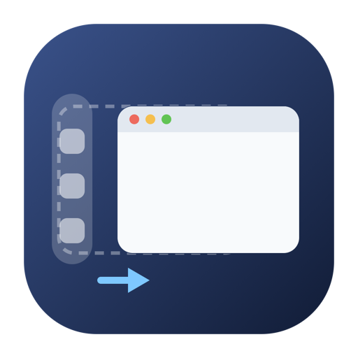
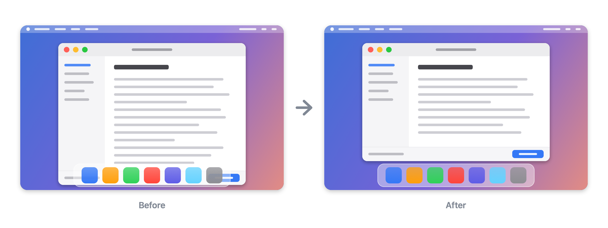

<p align="center"></p>

<h1 align="center">DockFixer</h1>

<p align="center">A small menu-bar app that keeps your windows out from under the Dock.</p>

<p align="center">
  <a href="https://github.com/ReppDen/dockfixer/releases/latest"></a>
  <a href="https://github.com/ReppDen/dockfixer/actions/workflows/ci.yml"></a>
  
  <a href="LICENSE"></a>
</p>

<p align="center"></p>

macOS lets windows sit under the Dock. Unplug a monitor and your windows land on
the laptop screen with their bottom edge behind it; an app restores a saved
window size and its status bar is under the Dock again. DockFixer notices these
windows and moves them just clear of the Dock, so you don't have to drag and
resize them by hand.

## Install

Requires macOS 14 Sonoma or later, Apple silicon or Intel.

**Homebrew**

```sh
brew install reppden/tap/dockfixer
```

**Download**

1. Download [DockFixer.zip](https://github.com/ReppDen/dockfixer/releases/latest/download/DockFixer.zip),
   unzip it and move `DockFixer.app` to Applications.
2. Open it. The first time, macOS will refuse: DockFixer is signed with the
   project's own certificate but not notarized by Apple, so macOS cannot check
   it. Close the message, open **System Settings → Privacy & Security**, scroll
   down and click **Open Anyway** next to the line about DockFixer, then confirm.
   On macOS 15 and later this is the only way; Control-click → Open no longer
   skips the check. Or do it in Terminal instead:

   ```sh
   xattr -dr com.apple.quarantine /Applications/DockFixer.app
   ```

   Homebrew does this step for you, and updates never need it again.

**Then grant Accessibility access.** Moving another app's windows is only
possible through the Accessibility API. On first launch DockFixer shows a
button that opens **System Settings → Privacy & Security → Accessibility**;
turn on the switch next to DockFixer and the window moves on to the settings.

DockFixer can only fix what happens while it runs, so turn on **Launch at
login**.

DockFixer collects usage statistics, and they are public:
[dashboard](https://eu.posthog.com/shared/O63pcUH2gzDFECtm1r3HAublIhL13w).
Turn off **Send usage statistics** in the settings to opt out.

## What it does

- **Moves windows out from under the Dock.** A window that opens there, comes
  back after ⌘H or on a Space you switch to, or ends up there after a display
  was unplugged or the Dock grew, is moved just clear of the Dock. If moving it
  is not enough to fit it on the screen, it is made narrower or shorter.
  **Fix Windows Now** does the same for every window on demand.
- **Keeps windows against the Dock.** When the Dock shrinks or moves to another
  edge, a window that was against it follows: stretched if it filled the
  screen, slid along otherwise. A window left a few points short of the Dock
  is put against it.
- **Fills the space the Dock leaves.** When the Dock moves to another display,
  for example because you plugged in a monitor, windows on the display it left
  stretch or slide into the strip it used.

Each of these is a switch, all on by default. The Dock can be on the left, the
bottom or the right; DockFixer reads the usable area of each screen from macOS
rather than looking for the Dock, so an auto-hidden Dock simply leaves nothing to
do. Dragging a window under the Dock yourself does not set anything off.

DockFixer is not a window manager. It moves windows only when the Dock is in
their way or has just moved, so it runs fine next to Rectangle, Magnet or any
other tiling app.

Some windows cannot be moved through the Accessibility API (fixed-size dialogs,
some Java and Qt apps), and windows on other Spaces are only seen when you
switch to them. Full-screen and minimized windows are left alone. Anything
DockFixer tried and could not do is written to the log with the reason.

## Updates

DockFixer checks for a new version once a day and installs it with
[Sparkle](https://sparkle-project.org) when its window is closed. Turn off
**Install updates automatically** and it asks first. The Accessibility
permission stays across updates.

## Privacy

DockFixer collects usage statistics. The totals are public:
[dashboard](https://eu.posthog.com/shared/O63pcUH2gzDFECtm1r3HAublIhL13w).
Turn off **Send usage statistics** in the settings and nothing is sent.

<details>
<summary>Exactly what is sent</summary>

```json
{
  "event": "day",
  "distinct_id": "a random ID made on this Mac, nothing else is derived from it",
  "uuid": "made from that ID and the day, so a day is never counted twice",
  "timestamp": "2026-10-13T00:00:00Z",
  "properties": {
    "version": "0.1.0",
    "day": "2026-10-13",
    "pushedOut": 11,
    "stuck": 40,
    "acrossDisplays": 3,
    "$geoip_disable": true
  }
}
```

The three numbers are how many windows each of the three switches moved that
day. One more event goes out when a "DockFixer saved you N hours" notification
is shown, and again if you click it:

```json
{
  "event": "notification",
  "distinct_id": "the same random ID",
  "uuid": "a random ID for this event",
  "timestamp": "2026-10-16T14:05:09Z",
  "properties": {
    "action": "shown",
    "hours": 3,
    "version": "0.1.0",
    "$geoip_disable": true
  }
}
```

`action` is `shown` or `clicked`, and `hours` is the number in the
notification. The PostHog project is set to discard IP addresses, and
`$geoip_disable` stops it from looking one up. Counts are kept in
`~/Library/Application Support/DockFixer/usage.jsonl` until the UTC day is over,
and each send is a line in the log. A build without the project key, such as a
fork or a local build, sends nothing. The code is one file:
[`Usage.swift`](Sources/DockFixerCore/Usage.swift).

</details>

**Report a Bug** in the app sends nothing until you press Send. Then it sends
what you wrote, your email if you gave one, the DockFixer and macOS versions,
your DockFixer settings and screens, and, unless you untick it, the last 24
hours of the log. The log names the apps DockFixer moved windows of and the
first 30 characters of their titles; **See What's Sent** shows it first.
Reports go to the same PostHog project and are read only by the developer.

## Bugs and questions

Use **Report a Bug** in the app, or [open an issue](https://github.com/ReppDen/dockfixer/issues/new/choose)
and attach the log: `~/Library/Logs/DockFixer/dockfixer.log` (**Show Log** in
the app's window has Copy Log and Reveal in Finder). Questions go to
[Discussions](https://github.com/ReppDen/dockfixer/discussions).

## Uninstall

Turn off **Launch at login** first: only the app itself can remove its login
item. Then quit DockFixer and delete it, or run
`brew uninstall --zap dockfixer`.

## Building from source

```sh
xcode-select --install   # Command Line Tools are enough, no Xcode needed
git clone https://github.com/ReppDen/dockfixer.git
cd dockfixer
make dev                 # builds, signs with a local certificate, installs to /Applications
```

See [CONTRIBUTING.md](CONTRIBUTING.md) for the rest.

## License

MIT, see [LICENSE](LICENSE). Third-party material:
[THIRD_PARTY_NOTICES.md](THIRD_PARTY_NOTICES.md).
