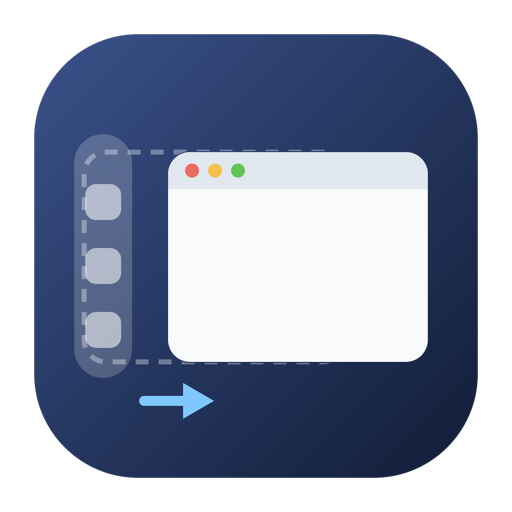
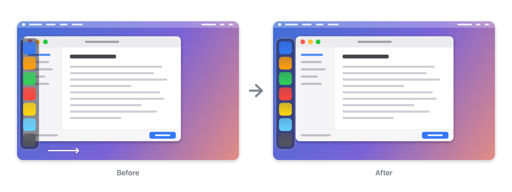
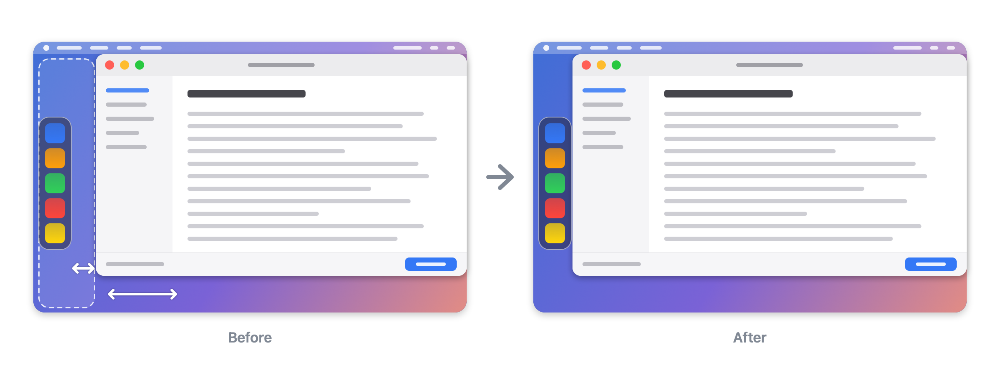
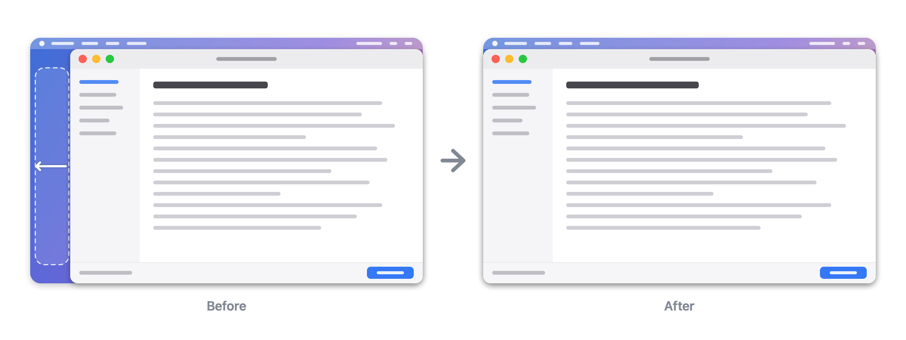

<p align="center"></p>

<h1 align="center">DockFixer</h1>

<p align="center">A small menu-bar app that keeps your windows out from under the Dock.</p>

<p align="center">
  <a href="https://github.com/ReppDen/dockfixer/releases/latest"></a>
  <a href="https://github.com/ReppDen/dockfixer/actions/workflows/ci.yml"></a>
  
  <a href="LICENSE"></a>
</p>

The Dock and windows on macOS are not friends. A window often opens partly under
the Dock. When an app opens or quits, the Dock changes size. Now the windows next
to it are under it, or there is a gap between them and the Dock. I got tired of
moving windows back by hand. So I made DockFixer. Free and open source.

## What it does

DockFixer works with the Dock on the left, at the bottom or on the right.

### Moves windows out from under the Dock

A window can end up under the Dock when it opens, when you move it to another
screen or when you unplug a display. DockFixer moves it out, so you can use all
of it.

<p align="center"></p>

### Sticks windows to the Dock

The Dock gets bigger or smaller when apps open and close. A window that was
next to the Dock moves with it, like a magnet.

<p align="center"></p>

### Fills the space the Dock leaves

When the Dock moves to another display, for example because you plugged in a
monitor, windows on the display it left stretch or slide into the empty space.

<p align="center"></p>

DockFixer also shows how many windows it moved and how much time that saved you.

Some windows cannot be moved through the Accessibility API (fixed-size dialogs,
some Java and Qt apps), and windows on other Spaces are only seen when you
switch to them. Full-screen and minimized windows are left alone. Anything
DockFixer tried and could not do is written to the log with the reason.

## Install

Requires macOS 14 Sonoma or later, Apple silicon or Intel.

### With Homebrew (recommended)

```sh
brew install reppden/tap/dockfixer
```

<details>
<summary>Don't have Homebrew?</summary>

Install it from [brew.sh](https://brew.sh) by pasting this into Terminal:

```sh
/bin/bash -c "$(curl -fsSL https://raw.githubusercontent.com/Homebrew/install/HEAD/install.sh)"
```

</details>

### Or download it yourself

1. Download [DockFixer.zip](https://github.com/ReppDen/dockfixer/releases/latest/download/DockFixer.zip).
2. Unzip it.
3. Move `DockFixer.app` to Applications.

The first time you open DockFixer, macOS will not open it and says it cannot
check the app. This is normal for a free app that is not in the App Store:
Apple checks only apps from paid developer accounts. Allow it once:

1. Close the message.
2. Open **System Settings → Privacy & Security**.
3. Scroll down and click **Open Anyway** next to the line about DockFixer.
4. Confirm.

### Allow Accessibility access

Moving another app's windows is only possible through the Accessibility API.
On first launch DockFixer shows a button that opens **System Settings → Privacy
& Security → Accessibility**; turn on the switch next to DockFixer.

## Updates

DockFixer automatically updates itself.

## Privacy

DockFixer collects no personal data. It sends only anonymous usage statistics,
and they are public: [dashboard](https://eu.posthog.com/shared/O63pcUH2gzDFECtm1r3HAublIhL13w).
Click the **Statistics** line in the settings to turn it off, and nothing is sent.

<details>
<summary>An example of what is sent</summary>

```json
{
  "event": "day",
  "distinct_id": "a random ID made on this Mac, nothing else is derived from it",
  "uuid": "the ID of this event",
  "timestamp": "2026-10-13T00:00:00Z",
  "properties": {
    "version": "0.1.0",
    "day": "2026-10-13",
    "pushedOut": 11,
    "stuck": 40,
    "acrossDisplays": 3
  }
}
```

The three numbers are how many windows each of the three switches moved that
day.

</details>

## Bugs and questions

Use **Report a Bug** in the app. It sends nothing until you press Send, and
only the developer reads the reports. Or [open an issue](https://github.com/ReppDen/dockfixer/issues/new/choose)
and attach the log: `~/Library/Logs/DockFixer/dockfixer.log`. Questions go to
[Discussions](https://github.com/ReppDen/dockfixer/discussions).

## Uninstall

Installed with Homebrew:

```sh
brew uninstall --zap dockfixer
```

Downloaded yourself: quit DockFixer and delete it from Applications.

## Building from source

```sh
xcode-select --install   # Command Line Tools are enough, no Xcode needed
git clone https://github.com/ReppDen/dockfixer.git
cd dockfixer
make dev                 # builds, signs with a local certificate, installs to /Applications
```

See [CONTRIBUTING.md](CONTRIBUTING.md) for the rest.

## Support the project

Show your support on [Buy Me a Coffee](https://buymeacoffee.com/reppden).

## License

MIT, see [LICENSE](LICENSE). Third-party material:
[THIRD_PARTY_NOTICES.md](THIRD_PARTY_NOTICES.md).
